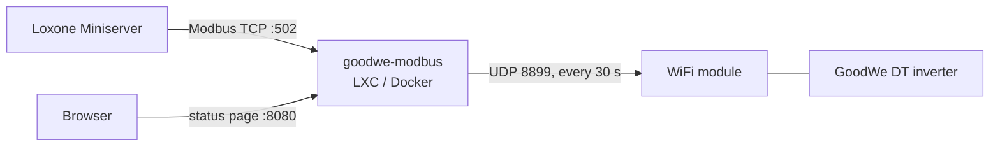

# Route C: goodwe-modbus bridge

A small service that reads the inverter over UDP 8899, exactly like Home Assistant, and offers it to
Loxone as a **Modbus TCP server with the inverter's own register addresses**.



- **Loxone uses its native Modbus support.** No virtual inputs, no logic.
- **Same addresses as the inverter.** The bridge template is the native template plus a few
  extension registers. If you move to RS485 or a Modbus TCP dongle later, only the address in
  Loxone changes.
- **One poll for everything.** Loxone reads from the bridge's cache as often as it likes; the
  WiFi module sees one request every 30 s.
- **Night handling.** When the inverter stops answering, power, current and voltage read 0, totals
  keep their value and *Energy today* resets at midnight, as Home Assistant does.
- **Extras**: PV power per string and total (V × I, as Home Assistant shows), power per phase,
  bridge status and data age, inverter clock sync.

Tested against a GW10KT-DT (firmware 15.15.35).

## Install

Any always-on Linux machine on the LAN, Python 3.9+, about 30 MB RAM. It can run next to
`onecta-modbus` (use a different Modbus port, see below).

### Proxmox LXC (Debian 12/13) or any Debian/Ubuntu machine

```bash
apt-get install -y git
git clone https://github.com/JannickNijholt/goodwe-loxone.git /opt/goodwe-modbus/src
/opt/goodwe-modbus/src/deploy/install.sh
```

Set the inverter IP in `/etc/goodwe-modbus.env` (`GOODWE_HOST=…`), then
`systemctl restart goodwe-modbus`. Status page: `http://<bridge-ip>:8080`. Logs:
`journalctl -u goodwe-modbus -f`.

To update: `git -C /opt/goodwe-modbus/src pull && /opt/goodwe-modbus/src/deploy/install.sh`.

### Docker

Set `GOODWE_HOST` in `docker-compose.yml`, then `docker compose up -d --build`.

## Loxone

1. Loxone Config → **Device templates → Import template** →
   [`loxone/templates/MB_GoodWe_DT_Bridge.xml`](../loxone/templates/MB_GoodWe_DT_Bridge.xml).
2. Add a **Modbus Server** from the template: address = bridge IP, port = `GOODWE_MODBUS_PORT`
   (502 by default). The unit ID doesn't matter.
3. Use the objects:

| What | Object | Register |
|---|---|---|
| PV power (as Home Assistant) | *PV power* | 1010 |
| AC output power | *AC output power* | 30127 |
| Energy today / total | *Energy today*, *Energy total* | 30144, 30145 |
| Grid voltage / current / frequency | *Grid L1…L3 voltage/current*, *Grid L1 frequency* | 30118–30124 |
| Inverter state | *Work mode* (0 wait, 1 normal, 2 error), *Error codes* | 30129, 30130 |
| Export limit (read/write) | *Grid export limit enabled*, *Grid export limit* | 40327, 40336 |
| Bridge health | *Bridge status* (0 online, 1 inverter asleep, 2 starting), *Data age* | 1000, 1001 |

Every register is listed in [registers.md](registers.md). The status page shows live values and
raw words.

## Writes

Off by default. Set `GOODWE_ALLOW_WRITES=1` to let Loxone change the export limit or sync the
inverter clock (write 1 to register 1020).

- Writes within 2 s are combined (slider moves). Only a value that differs from the inverter's is
  sent.
- At night, writes wait until the inverter answers again.
- Settings are stored in EEPROM, so at most 20 writes per hour go through
  (`GOODWE_MAX_WRITES_PER_HOUR`); *Last write result* (1004) shows what happened.
- *Grid export limit* (40336, 0–100 %) only applies while *Grid export limit enabled* (40327) is 1.
  What it does without a GoodWe smart meter is model-dependent: check before relying on it.

## Configuration

`/etc/goodwe-modbus.env` (LXC) or container environment. All optional except `GOODWE_HOST`:

| Variable | Default | Meaning |
|---|---|---|
| `GOODWE_HOST` | – | Inverter IP |
| `GOODWE_PORT` | 8899 | 8899 = WiFi module (UDP), 502 = Modbus TCP dongle |
| `GOODWE_COMM_ADDRESS` | 0x7F | Inverter Modbus address (goodwe library default for DT) |
| `GOODWE_MODBUS_PORT` | 502 | Port Loxone connects to. Use e.g. 503 if `onecta-modbus` runs on the same host |
| `GOODWE_WEB_PORT` | 8080 | Status page, 0 = off |
| `GOODWE_POLL_SECONDS` | 30 | Poll interval while the inverter answers |
| `GOODWE_OFFLINE_POLL_SECONDS` | 60 | Poll interval while it doesn't (night) |
| `GOODWE_OFFLINE_AFTER` | 3 | Missed reads before serving night values (UDP drops the odd packet) |
| `GOODWE_SETTINGS_SECONDS` | 600 | How often to re-read the export limit settings |
| `GOODWE_ALLOW_WRITES` | 0 | Accept writes from Loxone |
| `GOODWE_MAX_WRITES_PER_HOUR` | 20 | EEPROM guard |
| `GOODWE_WRITE_DEBOUNCE` | 2 | Seconds to collect writes |

The smart meter block is probed at start and every 6 hours. A GW10KT-DT without a meter simply
doesn't answer it, so it isn't polled in between.

## Home Assistant

The bridge and Home Assistant can poll the inverter at the same time. Once Loxone has taken over,
remove the GoodWe integration from Home Assistant so the WiFi module only has one client.

## Security

Modbus TCP has no authentication. Keep the port on the LAN (or restrict it to the Miniserver's IP
with a firewall), and leave writes off unless you use them. The status page is read-only.
